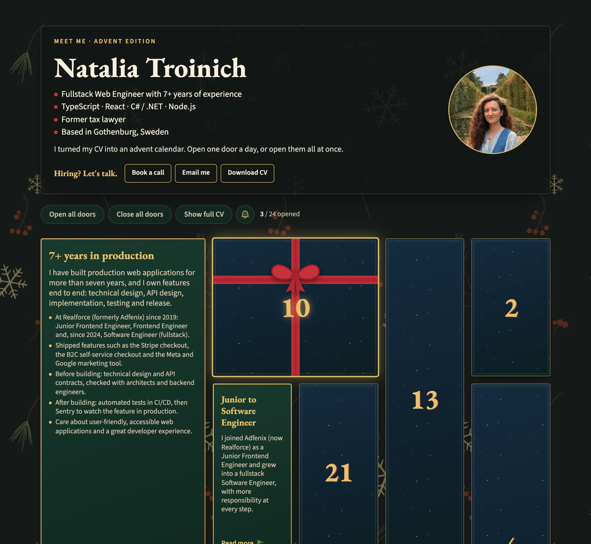
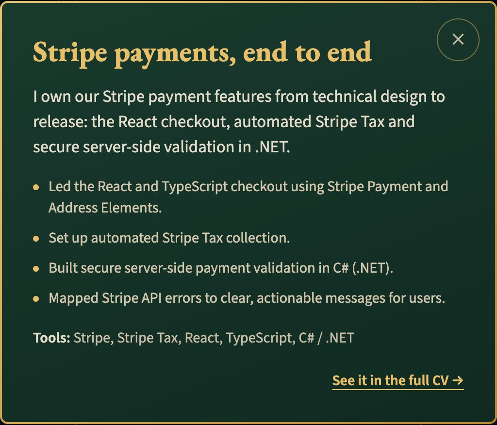
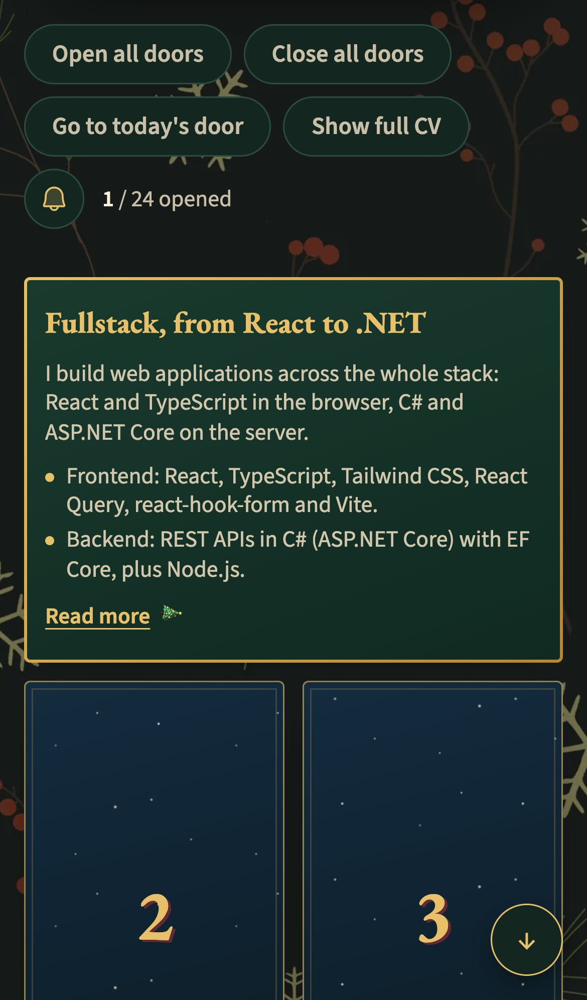
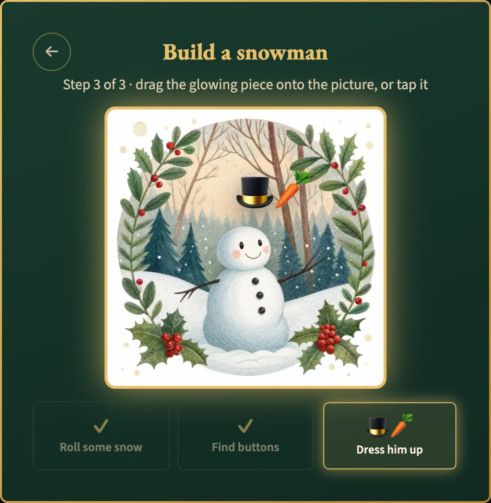

# Meet me: an advent calendar CV

[](https://github.com/troinich/troinich.github.io/actions/workflows/deploy.yml)

I'm Natalia Troinich, a fullstack web engineer in Gothenburg (TypeScript, React, C# / .NET). A PDF can't show how I build things, so I turned my CV into an advent calendar: 24 doors, each with one part of my experience, plus the full CV and the PDF one click away.

Two ways in:

- **[troinich.github.io/?open](https://troinich.github.io/?open)** opens the calendar straight away. This is the link I share with recruiters.
- **[troinich.github.io](https://troinich.github.io)** is the calendar as everyone else finds it. Before 1 December it is still locked: it says "Too early!" and offers a game, building a snowman in three clicks, to unlock it early (or "No, I'll wait" to read the full CV instead). In December it opens like the `?open` link.

Both links remember an unlock on your device, so after the `?open` link the plain one opens the calendar too. Use a private window to see the "Too early!" page again, or play just the snowman game with "Build a snowman" at the bottom of the page.



<table>
  <tr>
    <td width="33%"></td>
    <td width="33%"></td>
    <td width="33%"></td>
  </tr>
  <tr>
    <td align="center">"Read more" on a door</td>
    <td align="center">Phones: doors 1–24 in order</td>
    <td align="center">Build a snowman to unlock early</td>
  </tr>
</table>

## How it works

- **One door a day.** Today's door glows and wears a red ribbon. On tablets and desktops it is moved into the first two rows without leaving gaps in the grid, except door 24, the finale, which always stays in the middle; on phones the doors read 1–24 like a list, with a shortcut to today's door.
- **Too early?** Before December the calendar is locked. Visitors land on "Too early!" and can build a snowman in three steps (tap or drag each piece onto the picture) to unlock it early; winning is remembered on their device. "No, I'll wait" goes straight to the full CV, and the `?open` link skips the lock, so nobody has to play to read my CV. The snowman can also be built again any time from the footer, just for fun.
- **Every door has more.** Bigger doors show some details inline; "Read more" opens the whole story, and door 24 has the contact buttons and the full CV.
- **Easy to get in touch.** "Hiring? Let's talk." with Book a call, Email me and Download CV sits right in the intro; "Book a call" (my Cal.com page) glows three times after the page loads to show where to start. The full CV has "Book a call" and the PDF download in its top bar. Contacting me never depends on which door is open.

## Quality

| Lighthouse (production build) | Performance | Accessibility | Best practices | SEO |
| --- | --- | --- | --- | --- |
| Mobile | 99–100 | 100 | 100 | 100 |
| Desktop | 100 | 100 | 100 | 100 |

- **Accessible:** real buttons and dialogs with focus trapping, Escape and focus return; closed doors are `inert`, so keyboard users never land on hidden content; screen reader announcements; reduced motion respected; touch targets of at least 40px; colours checked for WCAG contrast. Automated axe scans find no WCAG 2.1 A/AA problems.
- **Tested in two layers:** about 100 Vitest + Testing Library tests that use the page the way a visitor does (by role and label, with a fixed date), and Playwright tests in real Chrome on a desktop and a phone screen for what a simulated DOM can't see: which element actually receives a click, the lock in a fresh browser, and the axe scans.
- **Gated deploys:** every push to `main` runs type-check, ESLint, unit tests, build and the Playwright checks before GitHub Pages publishes the site.
- **Light:** React is the only runtime dependency; images are WebP sized for Retina screens, and the page's HTML, CSS and JavaScript come to about 250 KB (about 75 KB gzipped).
- **Private by default:** analytics (GoatCounter, no personal data, plus anonymous counts of which contact buttons get clicked) load only after "Sure!" in the cookie question, and a later "No" switches them off again. My email address is never written in the page or the source; it is put together only when you click "Email me". Photos have their metadata removed.

## Built with

React 18, TypeScript, Vite, Tailwind CSS v4, Vitest, Testing Library, Playwright, axe-core, ESLint, GitHub Actions, GitHub Pages.

I built it with [Claude Code](https://claude.com/claude-code) as my pair programmer, the same way I work with AI agents at my job: a `CLAUDE.md` with the architecture and conventions, a short written spec per feature, review before every commit, and tests that have to pass before anything ships.

## Run it locally

```bash
npm install
npm run dev            # http://localhost:5173 (add ?open before December)
npm test               # unit and behaviour tests
npm run test:e2e       # Playwright in real Chrome (desktop + phone), with axe
npm run lint
npm run build          # type-check + production build into dist/
npm run screenshots    # retake the pictures in this README
```

## Where things are

```
src/App.tsx            which pop-up is showing, and the flows between them
src/data/doors.ts      the 24 doors (content is data)
src/data/cv.ts         the full CV
src/data/lock.ts       the December lock and the ?open link
src/config.ts          analytics code, jingle sound, booking link
src/components/        Door, Calendar, Header, CvView, SnowmanGame, CookieBanner, …
src/hooks/             useModal (focus trap, Escape, scroll lock), useOpenedDoors, …
e2e/                   Playwright real-browser and accessibility checks
scripts/screenshots.ts the README screenshots
```
